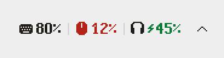

<p align="center"></p>

# 几格 / Jige Battery

几格在 Windows 任务栏上显示无线鼠标、键盘和耳机的电量：不用打开厂商驱动，看一眼就知道「还剩几格电」。电量低时提醒你充电，打游戏时不打扰。

- 官网：**https://jige.imfourj.cn**（国内直接访问，下载按钮自动指向最新版）
- 最新正式版：**v0.2.12**（[更新记录](CHANGELOG.md)）
- 系统要求：Windows 10 22H2 或 Windows 11，64 位
- 只读：只查询电量和状态，不改任何设备设置
- 开源：[MIT 许可证](LICENSE)

## 下载

| 渠道 | 安装包 | 校验文件 |
| --- | --- | --- |
| **国内镜像**（无需代理） | [Jige-Setup-0.2.12-x64.exe](https://download.imfourj.cn/jige-battery/releases/v0.2.12/Jige-Setup-0.2.12-x64.exe) | [SHA256SUMS.txt](https://download.imfourj.cn/jige-battery/releases/v0.2.12/SHA256SUMS.txt) |
| GitHub Release | [最新正式版](https://github.com/deepfry666/jige-battery/releases/latest) | 同页附带 |

国内镜像与 GitHub Release 的安装包完全相同。镜像上最新正式版的信息见 [`latest.json`](https://download.imfourj.cn/jige-battery/latest.json)。装好以后，在几格里点「检查更新」即可升级，不用再来这里下载。

下载后可以在 PowerShell 核对散列，结果应与 `SHA256SUMS.txt` 里的一致：

```powershell
Get-FileHash .\Jige-Setup-0.2.12-x64.exe -Algorithm SHA256
```

## 界面预览

任务栏直读条（程序按实际绘制代码导出，200% 缩放）：

<p><br>
</p>

Windows 实机截图待补，见 [截图目录](docs/images/README.md)。

## 功能

### 任务栏直读条（Windows 11）

在通知区（托盘上箭头）左边，横排显示每台设备的图标和电量百分比，字高与时钟一致：

- 电量低于提醒阈值：图标和数字变红；略高于阈值：琥珀色；
- 充电中或已充满：数字变绿，前面带一个闪电；
- 设备休眠：保留上次的读数和颜色；暂无读数：显示 `--`；
- 前台全屏或任务栏自动隐藏时，直读条跟着隐藏；
- 左键打开面板，右键打开菜单，悬停查看所有设备的详细列表。

直读条显示时，托盘里只保留一个「几格」图标作为面板入口。

### 托盘图标

以下情况几格改用托盘图标，每台设备一个：

- 在「设置 → 显示位置」里选了「托盘图标」；
- 任务栏上空间不够，或暂时无法定位任务栏。条件恢复后会自动回到直读条；
- Windows 10。它的任务栏结构不同，几格目前只在托盘里显示。

托盘图标把设备剪影当作电量计：电量越多，颜色从底部填得越高，没填到的部分显示为灰色。鼠标移到图标上会弹出悬停卡片，显示设备名称、连接方式、百分比和读取时间。

### 面板与设置

- **主面板**：单击直读条或托盘图标打开。电量最低的设备排在最上面，其余按电量从低到高排列，已断开的设备收进「离线设备」。`≈` 表示估算读数。
- **设置**（面板右上角齿轮）：
  - 显示位置：「任务栏（推荐）」或「托盘图标」；
  - 托盘显示：「自定义」（勾选要显示的设备）或「只显示电量最低的一台」；
  - 低电量提醒阈值（10%、15%、20%、30%）和查询间隔（30 秒、1 分钟、2 分钟）；
  - 「游戏中不打扰」「显示蓝牙设备」「开机时启动」。
- **管理设备**：改名、选择是否在托盘和面板显示、移除离线设备；「重新检测」会重新扫描接收器。

### 低电量提醒

设备在线、没在充电，并且连续两次查询的电量都不高于阈值时，几格会提醒你充电。可以选「知道了」或「1 小时后提醒」。提醒只在桌面上弹出，打游戏时会推迟。

### 不打扰游戏

- Windows 报告独占全屏或演示模式时，查询间隔延长到 5 分钟，提醒推迟；
- 打开「游戏中不打扰」后，普通全屏、无边框铺满屏幕的窗口，以及你配置的游戏进程，也按游戏处理；
- 你主动点托盘、菜单、「立即刷新」或「下载并安装」，任何时候都照常执行。

平时每分钟查询一次电量，另有很轻的在线心跳（平时 8 秒、游戏中 30 秒），用来尽快发现设备开关机。罗技接收器靠设备主动推送，不发心跳。动一下键鼠，会马上补查一次休眠中的设备，最多每 2 秒一次。

### 检查更新

只有你点「检查更新」时，几格才会去查新版本：优先访问国内镜像，失败时自动改用 GitHub。选「下载并安装」后，几格核对安装包大小和 SHA-256，校验通过后静默升级并自动重启，设置和设备记录都会保留。几格不会在后台检查更新，也不会弹出更新提示。

## 支持的设备

下表设备都经 2.4 GHz USB 接收器查询。「已实机验证」表示作者在自己的设备上确认过；「仅按资料」表示依据公开协议实现，欢迎反馈。

| 支持的设备 | 接收器与识别方式 | 证据等级 | 验证状态 |
| --- | --- | --- | --- |
| Sony INZONE H9 一代 | PC 档接收器 `054C:0E53` 的 `MI_06` USB 串口（INZONE Hub 运行时自动退让） | 多方开源实现一致 | **已实机验证**（Windows 11，2026-11-19） |
| 游狼 HTX Ultra 8K（XVI-NEW） | `33E4:5617`，`MI_02 / FFFF:0000` | 依据官方网页驱动型号表 | **已实机验证**（Windows 11，2026-11-19） |
| Razer BlackShark V3 Pro | `1532:0577`，`MI_05 / FF14:0001`（纯只读 `21/2A`） | 社区实机记录 | **已实机验证**（Windows 11，2026-11-20） |
| 游狼 XVI-NEW 同家族 | Fenrir Pro 8K `33E4:3617`、HTM Plus `33E4:3817`、HSK Pro 2.0 8K `33E4:6817`，`MI_02 / FFFF:0000` | 与已验证型号同协议家族、同官方型号表 | **同家族推定**（未在实机验证） |
| Finalmouse UltralightX（ULX） | 2.4 GHz 接收器 `361D:0100`，以及同家族 `361D` + `FF00:0001`（64/64）通用识别 | 单一来源 / 通用适配 | 仅按资料 |
| ATK Compx-OUT | `373B:1031`（F1 Ultimate）、共用接收器 `373B:101A/11D9/1278`（默认「ATK 鼠标」，协议返回 CID/MID 时显示具体型号），以及同家族 `373B` + `FF02:0002`（17/17）通用识别 | 多方开源实现一致 / 单一来源 / 通用适配 | 仅按资料 |
| ATK BitMouse | ATK ZERO `373B:1155`（`FF05:0001`），以及同家族 `373B` + `FF05:0001`（64/64）通用识别 | 多方开源实现一致 / 通用适配 | 仅按资料 |
| 游狼 XVI-OLD | 从官方网页驱动型号表导入 21 款 `XVI=1` 旧协议型号（如 HTX Mini 8K `33E4:2717`、VUK `33E4:3917`、HT-S2 / HTS Plus / HSK Pro 等），`MI_02 / FFFF:0000` | 依据官方网页驱动型号表 | 仅按资料 |
| [罗技 HID++](docs/protocols.md#罗技-hid-10-与-20) | Bolt、Unifying、Nano、LIGHTSPEED 及符合识别条件的接收器；支持老款 HID++ 1.0、USB 线缆及符合条件的罗技蓝牙鼠标和键盘 | Solaar / HaloBattery / Linux | 仅按资料 |
| [Windows 蓝牙电量](docs/protocols.md#windows-蓝牙电量属性) | Windows 提供电量的各品牌蓝牙外设。支持在设置里关闭显示，与同一台设备的 HID++ 电量自动合并 | Windows 设备属性 | 仅按资料 |
| [Logitech HID++ 耳机](docs/protocols.md#hid-耳机) | G533、G535、G733、G935、G PRO X Wireless 等匹配型号；部分读数为估算 | HaloBattery / HeadsetControl / Linux | 仅按资料 |
| [Logitech Centurion](docs/protocols.md#logitech-centurion-与-astro-a50-gen-5) | G PRO X 2、G522、G325 的无线接收器 | 多方开源实现一致 / 单一来源，按型号 | 仅按资料 |
| [ASTRO A50 Gen 5](docs/protocols.md#logitech-centurion-与-astro-a50-gen-5) | 底座 `046D:0B1C` | 单一来源 | 仅按资料 |
| [Razer 90B](docs/protocols.md#razer-90b-feature) | 72 个鼠标 PID、15 个键盘 PID（对齐 OpenRazer，含无线接收器、HyperPolling 接收器与 USB-C 有线充电模式；协议忙或被其他软件临时占用时自动重试最多 3 次） | 多方开源实现一致 / 单一来源，按型号 | 仅按资料 |
| [Razer BlackShark 纯只读耳机](docs/protocols.md#razer-pa-与-blackshark-64b) | BlackShark V2 Pro (2020) `1532:0528`（`FF00:0001` 64B Feature）、BlackShark V2 HyperSpeed `1532:0565`（MI_03）、BlackShark V3 `1532:057A`（MI_05） | 多方开源实现一致 / 单一来源 | 仅按资料 |
| ASUS ROG 无线键盘 | `0B05:1934`、Falchion、Claymore II、Azoth 系列、Strix Scope II 96 等（`MI_01 / FF00:0001` 65B 只读命令 `12 01`） | G-Helper / HaloBattery（MIT） | 仅按资料 |
| MCHOSE 迈从键盘 | MCHOSE K87 2.4G 接收器 `41E4:2001`（`FF02:0002` 20B 只读命令 `13 4A`） | HaloBattery（MIT） | 仅按资料 |
| 暂未启用路径（路径开关） | 雷蛇 PA（`0555/0556/0557/0583/053A/0536`）、Barracuda X Macronix（`0552`）、V2 Pro 2020 充电线（`052E`）、ATK A9 Ultra（`373B:111A`）、游狼 Receiver RS（`33E4:3854`）、Fenrir Asym（`33E4:3517`）、ASTRO A50 X（`046D:0B0B`）、罗技 PRO X 3（`046D:0B45`） | 违背只读原则、协议冲突或尚缺接口特征，打开句柄前跳过 | 暂未启用 |

罗技 MX Keys S、MX Anywhere 3S 已通过 Bolt 接收器在 Windows 10 上日常使用。完整设备表、三级验证状态和暂未启用的原因见 [设备支持清单](docs/devices.md)，其余候选型号见 [设备清单](research/device-catalog.md)。

你的设备不在表里，或读数不对？在几格里导出诊断报告，再按 [CONTRIBUTING.md](CONTRIBUTING.md) 提交设备反馈。

## 安装

1. 从上面的「下载」获取安装包，按需核对散列。
2. 运行安装器。可以选择安装位置（默认 `%LOCALAPPDATA%\Programs\Jige`，不需要管理员权限），按需勾选「创建桌面快捷方式」；首次安装还可以勾选「开机时启动几格」。
3. 从桌面或开始菜单打开「几格」。首次运行时，可以按提示把托盘溢出区里的「几格」图标拖到时钟旁。

卸载：在 Windows 的「已安装的应用」（或「应用和功能」）里卸载。卸载时会询问是否同时清除设置、电量记录、日志和诊断。

## 使用前提与只读声明

几格面向这样的用户：在厂商软件里把设备调好以后，平时不再让官方驱动在后台运行。官方软件正在运行时，可能会占用接收器。INZONE Hub 会独占 H9 的串口，几格检测到它在运行时会主动退让。遇到占用时，几格结束这台设备本轮的读取，保留上次的读数。

几格只发送白名单内的电量与状态查询（链路、充电、电压、设备身份），使用 Windows 自带的驱动，查询结束就释放设备。协议来自公开的社区逆向资料和网页驱动的公开行为，仅用于显示电量。几格与各厂商无关，也未获厂商授权。

## 配置与缓存

- `%LOCALAPPDATA%\Jige\config.json`：显示位置、托盘模式、各设备的显示选择、提醒阈值、查询间隔、游戏保护、开机自启、设备别名。配置损坏时，保留一份 `config.broken-<时间>.json`，再恢复默认值。
- 游戏以普通窗口运行时，可以先退出几格，再在 `config.json` 里加上 `"gameProcessNames": ["Game.exe"]`（进程名见任务管理器，不区分大小写，可省略 `.exe`）。
- `%LOCALAPPDATA%\Jige\state.json`：最近一次成功读数、提醒状态、每台设备最近 5 次读数。电量或状态有变化时才写盘。
- `%LOCALAPPDATA%\Jige\jige.log`：脱敏日志，只记录状态变化和原因类别。
- 开机自启使用当前用户 Run 项里的 `Jige Battery` 值。

## 诊断与隐私

诊断报告只在你主动导出时生成：右键菜单或「管理设备」页 →「诊断信息」。报告保存在本机，先用记事本完整打开给你看，确认后才由你决定是否复制，可点「复制报告并去反馈」打开反馈模板（网址里不带任何报告内容）。报告已脱敏，不含序列号、电脑名、用户名和路径，也不记录键鼠输入。收集的字段和示例见 [PRIVACY.md](PRIVACY.md)，抓包方法见 [抓包教程](docs/capture-guide.md)。

## 命令行探针

探针 `Jige.Probe.exe` 用于排查设备，由 Windows CI 单独构建（产物 `jige-probe-win-x64`）。在 PowerShell 中运行，H9 接收器须拨到 PC 档：

```powershell
.\Jige.Probe.exe list                          # 列出 HID 接口和 USB 串口
.\Jige.Probe.exe read                          # 对识别出的设备各查询一次
.\Jige.Probe.exe read --raw                    # 同时输出原始收发帧（可能含设备标识）
.\Jige.Probe.exe read --raw --sony-baud both   # H9 分别尝试 115200 和 460800
.\Jige.Probe.exe diag                          # 输出脱敏诊断报告
```

需要分享时，请用脱敏的 `diag` 报告，不要用 `--raw` 的输出。

## 构建与测试

在仓库根目录用 .NET 10 运行。macOS 上可以编译托管项目，运行协议、模拟传输、托盘逻辑和配置测试；设备访问、窗口和原生发布需要在 Windows 上运行。

```sh
dotnet build Jige.slnx -p:EnableWindowsTargeting=true
dotnet test Jige.slnx
```

Windows 本地发布 NativeAOT 需要 Visual Studio 的 C++ 桌面开发工具：

```powershell
dotnet publish src/Jige.Probe/Jige.Probe.csproj -c Release -r win-x64 -p:PublishAot=true -o artifacts/win-x64
dotnet publish src/Jige.Tray/Jige.Tray.csproj -c Release -r win-x64 -p:PublishAot=true -o artifacts/tray-win-x64
```

### 发布流程

- 每次推送到 `main`，CI 都会运行测试、发布两个 NativeAOT 程序、做托盘启动自检，并更新滚动测试版 [`prerelease-build`](https://github.com/deepfry666/jige-battery/releases/tag/prerelease-build)（国内镜像：[安装包](https://download.imfourj.cn/jige-battery/prerelease/Jige-Setup-prerelease-x64.exe) · [SHA256SUMS.txt](https://download.imfourj.cn/jige-battery/prerelease/SHA256SUMS.txt)）。几格内置的检查更新只看正式版。
- 发布正式版：确认 `Directory.Build.props` 和 `installer/jige.iss` 的版本号，在 [CHANGELOG.md](CHANGELOG.md) 写好 `## [x.y.z]`，然后打标签推送：

  ```sh
  git tag vX.Y.Z
  git push origin vX.Y.Z
  ```

  发布工作流会运行测试和托盘自检，用 `installer/jige.iss` 编译安装器，上传安装包和 `SHA256SUMS.txt`，创建 GitHub Release，并同步到国内镜像。发布后把 `main` 的版本号升到下一个。
- 安装器也可以在 Windows 本地复现：先发布托盘，再运行 `ISCC.exe /DAppVersion=x.y.z installer\jige.iss`。重新生成品牌资源：`python3 scripts/generate-icons.py`（需要 Node.js、npx 和 Pillow）。

## 待实机确认

- 任务栏直读条在 Windows 11 上的位置和层级：点开开始菜单、通知中心以后是否还在；自动隐藏任务栏、Explorer 重启、全屏游戏进出时的表现；100%、150%、200% 缩放下与时钟的大小是否协调。
- 托盘水位图标在深浅色任务栏、不同缩放下的清晰度。
- 标为「仅按资料」的设备的实际读数。

## 致谢与参考

- Finalmouse XPanel、官方 USB 权限清单以及 HaloBattery 的 ULX 报文与实机记录。[XPanel](https://xpanel.finalmouse.com/) · [USB 权限清单](https://github.com/teamfinalmouse/xpanel-linux-permissions) · [HaloBattery](https://github.com/HeyOkay/HaloBattery)
- InZoneH9Tray、openinzone 与 inzone-h9-mac 提供 H9 串口查询、帧格式及实机记录。[InZoneH9Tray](https://github.com/janit88/InZoneH9Tray) · [openinzone](https://github.com/penguinwokrs/openinzone) · [inzone-h9-mac](https://github.com/jpcarranza94/inzone-h9-mac)
- Solaar（GPL-2.0，部分文件 GPL-2.0-or-later）、OpenLogi（MIT 或 Apache-2.0）、OpenMouse mouse-protocol（AGPL-3.0）提供 HID++ 的槽、身份和电量协议资料。[Solaar](https://github.com/pwr-Solaar/Solaar) · [OpenLogi](https://github.com/AprilNEA/OpenLogi) · [OpenMouse](https://github.com/OpenMouse-Project/mouse-protocol)
- HeadsetControl（GPL-3.0）提供 Centurion、G325 和 ASTRO Gen 5 的报文与实机记录。[HeadsetControl](https://github.com/Sapd/HeadsetControl)
- OpenRazer（GPL-2.0）、Razer Battery Report（MIT）、HaloBattery（MIT）、BlackShark V2 HyperSpeed WebHID（MIT）与 Synapse-for-Linux（MIT）提供雷蛇 PID、接口、读电量与充电的报文和实机证据。[OpenRazer](https://github.com/openrazer/openrazer) · [Razer Battery Report](https://github.com/xzeldon/razer-battery-report) · [HaloBattery](https://github.com/HeyOkay/HaloBattery) · [V2 HyperSpeed WebHID](https://github.com/justik13/razer-blackshark-v2-hyperspeed-webhid) · [Synapse-for-Linux](https://github.com/bbesli/Synapse-for-Linux)

几格依据公开协议字段和实机报文独立实现，不复制 GPL 代码，保留 MIT 许可。许可出处见 [设备清单](research/device-catalog.md#6-参考实现许可证)，协议字段、出处和验证状态见 [协议记录](docs/protocols.md)。
