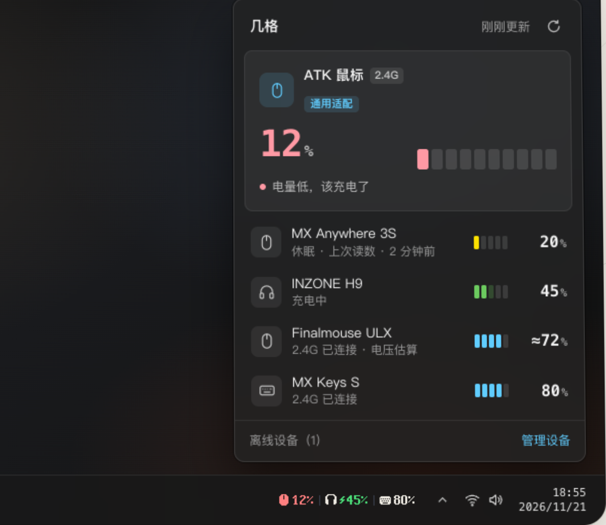
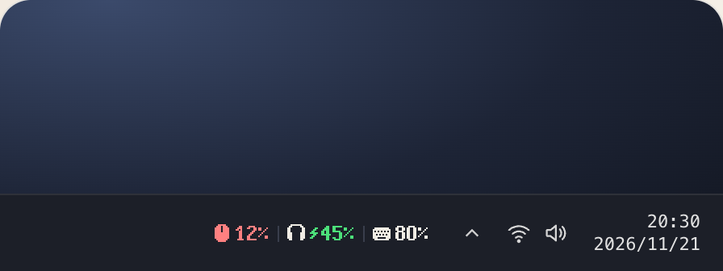
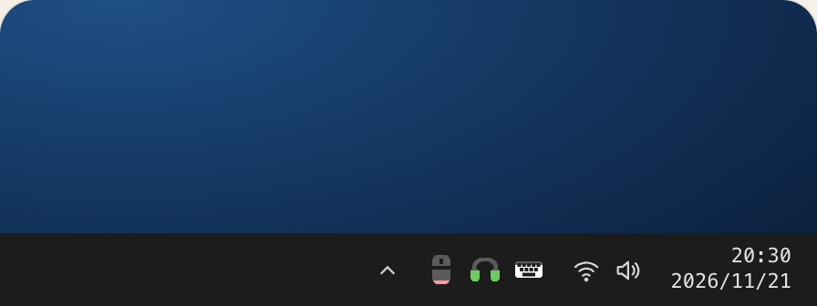

<p align="center"></p>

<h1 align="center">几格 · Jige Battery</h1>

<p align="center"><b>不开厂商驱动，也能在 Windows 任务栏上看到无线鼠标、键盘和耳机的电量。</b></p>
<p align="center"><sub>Lightweight, read-only Windows taskbar battery monitor for 2.4 GHz &amp; Bluetooth wireless peripherals — no vendor bloatware required.</sub></p>

<p align="center">
  <a href="https://github.com/deepfry666/jige-battery/releases/latest"></a>
  <a href="LICENSE"></a>
  
  
</p>

<p align="center">
  <a href="https://jige.imfourj.cn"><b>🌐 官网与在线演示</b></a> ·
  <a href="https://jige.imfourj.cn/download.html"><b>⬇️ 下载与安装指南</b></a> ·
  <a href="docs/devices.md">支持的设备</a> ·
  <a href="CHANGELOG.md">更新记录</a> ·
  <a href="https://github.com/deepfry666/jige-battery/issues/new?template=device-report.yml">提交新设备适配</a>
</p>

<p align="center"></p>

<details>
<summary><b>English Overview</b></summary>

**Jige Battery (几格)** shows the battery levels of your 2.4 GHz wireless & Bluetooth mice, keyboards, and headsets directly on the Windows 10 / 11 taskbar — so you can keep heavy vendor apps (Synapse, G HUB, INZONE Hub, etc.) completely closed.

- **Direct & Read-Only**: Talks to USB 2.4 GHz receivers via whitelisted read-only HID/serial queries only. Never modifies DPI, RGB, macros, or firmware, and backs off automatically when official vendor software is open.
- **Zero Disturbance While Gaming**: Automatically hides and pauses popups in exclusive fullscreen games, with an optional click-through banner on game launch if a device is low.
- **Tiny & Native**: Single-process C# .NET 10 NativeAOT binary (~5 MB installer), no runtime required, no admin privileges, no telemetry.
- **Download**: [Latest GitHub Release](https://github.com/deepfry666/jige-battery/releases/latest) · [Official Site & Interactive Demo](https://jige.imfourj.cn)
- **Device not listed?** Export a sanitized `diagnostics.txt` inside Jige and open a [Device Report](https://github.com/deepfry666/jige-battery/issues/new?template=device-report.yml) (see [CONTRIBUTING.md#english](CONTRIBUTING.md#english)).

</details>

## 它解决什么问题

在雷蛇、罗技或各家驱动里调好灵敏度和回报率后，很多人会把驱动关掉，免得常驻后台占内存、影响游戏。可关掉之后就看不到电量了，经常打到一半鼠标突然没电；桌面上同时用几个牌子的话，为了看个电量还得开两三个客户端。

**几格直接和 USB 接收器通信，只发白名单只读查电指令**，厂商驱动可以一直关着，一个 ~5 MB 的小工具就能同时看全多个品牌的无线外设。

| 核心优势 | 说明 |
| --- | --- |
| **不开厂商驱动** | 直连 2.4 GHz 接收器与 Windows 蓝牙电量，多品牌统一显示 |
| **纯只读 · 零遥测** | 只查电量与连接状态，不碰设置与固件，不上传任何个人或设备数据 |
| **打游戏不打扰** | 独占全屏不弹窗、不抢焦点，轮询自动降频至 5 分钟 |
| **极轻原生编译** | C# .NET 10 NativeAOT 单进程，约 5 MB，免安装运行库、免管理员权限 |

## 在任务栏上的样子

Windows 10 和 Windows 11 默认都使用**任务栏直读条**，并内置 **5 种样式**（自动融入、极简无框、磨砂胶囊、分块徽章、底栏格条）与 **9 套配色**，实时自适应深浅色、彩色主题与半透明任务栏背景。也可以在「设置 → 显示位置」切换为**托盘图标**（任务栏不在底部或空间不足时也会自动临时回退）。

| 任务栏直读条（默认 · Win10 / Win11） | 托盘图标（可选 / 空间不足时自动回退） |
| --- | --- |
|  |  |
| 通知区左侧横排显示每台设备的图标和电量，字和时钟一样大。 | 每台设备一个图标，设备剪影就是电量计，电量越多填得越高。 |

两种显示的颜色规则一致：低于提醒阈值变红，略高于阈值变黄，充电中变绿并带闪电标志。

## 功能

- **一眼看电量**：任务栏常驻显示，支持 5 种直读条样式与 9 套配色实时切换；悬停卡片查看全部设备名称、状态、上次充电时间与读取时间。
- **主面板与自定义管理**：单击打开，支持跟随系统 / 明亮 / 深色外观模式；电量最低的设备排在最上方，断开的设备收进「离线设备」；可改名、勾选显示哪些设备、给单台设备设独立提醒阈值（5%～30%）。
- **预计可用与充满时间**（可选，默认关闭）：仅依据本机已有耗电与分段充电记录估算「还能用多久 / 够用约几天 / 约多久充满」，不向设备多发任何查询。
- **电量提醒**：低电量桌面提醒（支持「1 小时后提醒」）；刚进游戏时若有低电量设备，可在右下角弹一条可点穿、不抢焦点的小横幅（独占全屏不弹）；也支持「撑不过今天」预测提醒和充满提醒拔线。
- **不打扰游戏**：独占全屏游戏时自动隐藏直读条、不弹窗、不抢焦点，查询放慢到 5 分钟一次，切回桌面即恢复显示并补发提醒。
- **静默自动更新**：每天检查一次正式版（优先国内镜像，异常自动回退 GitHub），后台下载并核对大小与 SHA-256，面板底部提示「新版已就绪」，点一下才升级；可在设置里关闭。
- **轻量可靠**：NativeAOT 原生编译，单个进程，无需 .NET 运行库，无需管理员权限。

## 下载安装

| 渠道 | 链接 |
| --- | --- |
| **国内镜像**（不用代理） | [Jige-Setup-0.2.21-x64.exe](https://download.imfourj.cn/jige-battery/releases/v0.2.21/Jige-Setup-0.2.21-x64.exe) · [SHA256SUMS.txt](https://download.imfourj.cn/jige-battery/releases/v0.2.21/SHA256SUMS.txt) |
| GitHub Release | [最新正式版](https://github.com/deepfry666/jige-battery/releases/latest) |

两个渠道的安装包完全相同。运行安装器即可，默认装到 `%LOCALAPPDATA%\Programs\Jige`，可以勾选开机启动。安装包暂时没有代码签名，Windows 可能提示「已保护你的电脑」，点「更多信息 → 仍要运行」就行，详细步骤见 [下载与安装指南](https://jige.imfourj.cn/download.html)。

想核对文件，可以在 PowerShell 里运行下面的命令，结果应和 `SHA256SUMS.txt` 一致：

```powershell
Get-FileHash .\Jige-Setup-0.2.21-x64.exe -Algorithm SHA256
```

卸载：在 Windows「已安装的应用」里卸载，卸载时可以选择是否一起清除设置和记录。

## 支持的设备

通过 2.4 GHz USB 接收器读取，也支持 Windows 能读到电量的蓝牙设备。

| 品牌 | 覆盖范围 | 实机验证 |
| --- | --- | --- |
| Sony INZONE | INZONE H9 一代 | ✅ |
| 游狼 G-Wolves | HTX Ultra 8K，以及同协议的 Fenrir Pro 8K、HTM Plus、HSK Pro 2.0 8K 和 21 款旧协议型号 | ✅ HTX Ultra 8K |
| 雷蛇 Razer | 72 款鼠标、15 款键盘，BlackShark V3 Pro / V3 / V2 HyperSpeed / V2 Pro (2020) 耳机 | ✅ BlackShark V3 Pro |
| ASUS ROG / TUF | Falchion / Azoth / Scope II 96 键盘，Gladius III / Harpe Ace / Keris / Chakram 等 33 个鼠标 PID，OMNI 接收器，Strix Go 2.4 耳机 | ✅ 无线键盘 |
| 罗技 Logitech | Bolt、Unifying、LIGHTSPEED 等接收器，G533 / G535 / G733 / G PRO X 等耳机 | MX Keys S、MX Anywhere 3S 日常在用 |
| 赛睿 SteelSeries | Arctis Nova 7 / 5 / 3P / 3X / Pro、Arctis 1 / 7 / 7+ / 9 / Pro、GameBuds 耳机，Aerox 3/5/9、Rival 3 鼠标 | 按协议资料 |
| HyperX 极度未知 | Cloud II / II Core / Flight / Alpha / III / III S Wireless 无线耳机 | 按协议资料 |
| 海盗船 Corsair | Void Elite / Void v2 / HS80 / Virtuoso SE / XT / Max 耳机，Dark Core / M75 / Sabre v2 Pro 鼠标，K65 PLUS 键盘 | 按协议资料 |
| Pulsar · Hitscan · Glorious · Endgame Gear | Pulsar X2 V2 / V3 / CrazyLight，Hitscan Hyperlight，Glorious Model O Wireless，Endgame Gear XM2we | 按协议资料 |
| Cougar · Redragon · Audeze · Keychron | Cougar Revenger Pro，Redragon M991，Audeze Maxwell 耳机，Keychron Ultra-Link 8K / M5 / Nape Pro | 按协议资料 |
| ATK | F1 Ultimate、ATK ZERO，以及同家族接收器 | 按协议资料 |
| VXE · VGN · Scyrox | VXE R1 系列、MAD，VGN 蜻蜓 F1 / F2 Master / Y2 / Dragonfly 3 Master，Scyrox V8 等 | 按协议资料 |
| Lamzu · WLmouse | Lamzu Maya X，WLmouse Beast X 系列 | 按协议资料 |
| 迈从 MCHOSE | A5 Pro Max 初代、M7 Ultra、L7 Pro、A7 V2 Ultra、V3 鼠标，K87 键盘 | 按协议资料 |
| 达尔优 · 黑爵 · 前行者 · 狼蛛 | DAREU A950，AJAZZ AJ179 V2 MAX / Pro，EWEADN S9 / H2，AULA F87 Pro V2C 键盘 | 按协议资料 |
| ATTACK SHARK · Delux · 英菲克 | ATTACK SHARK 鼠标、Delux 鼠标、Inphic IN9 Pro | 按协议资料 |
| 雷柏 Rapoo · Incott | VT7、VT9 Pro、VT9 Pro V2，Incott 8K 鼠标 | 按协议资料 |
| Finalmouse | UltralightX（ULX） | 按协议资料 |

「按协议资料」表示依据公开的协议资料实现，还没有在实机上确认。

<details>
<summary><b>展开：完整型号、接收器 ID 和验证状态</b></summary>

| 支持的设备 | 接收器与识别方式 | 证据等级 | 验证状态 |
| --- | --- | --- | --- |
| Sony INZONE H9 一代 | PC 档接收器 `054C:0E53` 的 `MI_06` USB 串口（INZONE Hub 运行时自动退让） | 多方开源实现一致 | **已实机验证**（Windows 11，2026-11-19） |
| 游狼 HTX Ultra 8K（XVI-NEW） | `33E4:5617`，`MI_02 / FFFF:0000` | 依据官方网页驱动型号表 | **已实机验证**（Windows 11，2026-11-19） |
| Razer BlackShark V3 Pro | `1532:0577`，`MI_05 / FF14:0001`（纯只读 `21/2A`） | 社区实机记录 | **已实机验证**（Windows 11，2026-11-20） |
| ASUS ROG 无线键盘 | `0B05:1934`，`MI_01 / FF00:0001`（纯只读 `12 01`） | G-Helper | **已实机验证**（Windows 11，2026-11-20） |
| 游狼 XVI-NEW 同家族 | Fenrir Pro 8K `33E4:3617`、HTM Plus `33E4:3817`、HSK Pro 2.0 8K `33E4:6817`，`MI_02 / FFFF:0000` | 与已验证型号同协议家族、同官方型号表 | **同家族推定**（未在实机验证） |
| Finalmouse UltralightX（ULX） | 2.4 GHz 接收器 `361D:0100`，以及同家族 `361D` + `FF00:0001`（64/64）通用识别 | 单一来源 / 通用适配 | 仅按资料 |
| ATK Compx-OUT | `373B:1031`（F1 Ultimate）、共用接收器 `373B:101A/11D9/1278`（默认「ATK 鼠标」，协议返回 CID/MID 时显示具体型号），以及同家族 `373B` + `FF02:0002`（17/17）通用识别 | 多方开源实现一致 / 单一来源 / 通用适配 | 仅按资料 |
| ATK BitMouse | ATK ZERO `373B:1155`（`FF05:0001`），以及同家族 `373B` + `FF05:0001`（64/64）通用识别 | 多方开源实现一致 / 通用适配 | 仅按资料 |
| 游狼 XVI-OLD | 从官方网页驱动型号表导入 21 款 `XVI=1` 旧协议型号（如 HTX Mini 8K `33E4:2717`、VUK `33E4:3917`、HT-S2 / HTS Plus / HSK Pro 等），`MI_02 / FFFF:0000` | 依据官方网页驱动型号表 | 仅按资料 |
| VXE R1 系列 / MAD | `3554:F58A`、`3554:F505`、`3554:F58E`、`373B:1040`、`373B:1085`，Compx-OUT | atk-control / HaloBattery / mouse_tray | 仅按资料 |
| Scyrox / Compx 共享接收器 | `3554:F5F7`、`3554:F5F4`、`3554:F517`、`3554:F50D`，Compx-OUT | Scyrox S-center / HaloBattery / Lamzu Aurora / Control HUB | 仅按资料 |
| VGN 蜻蜓 F1 / F2 Master / Y2 / Dragonfly 3 Master | `3554:F503`、`3554:F50B`、`3554:F505`、`3554:FB56`、`3554:FB3E`、`3554:FB52`、`3554:FB54`、`3554:FB58`，Compx-OUT | VGN HUB | 仅按资料 |
| Lamzu Maya X | `373E:001D`（1K）、`373E:001E`（8K），XVI-NEW | Lamzu Aurora / HaloBattery | 仅按资料 |
| WLmouse Beast X 系列 | `36A7:A880`、`36A7:A868`、`36A7:A883`、`36A7:A887`、`36A7:A882`，XVI-NEW | WL MOUSE HUB / HaloBattery | 仅按资料 |
| MCHOSE A5 Pro Max 初代 | `2023:F013`（1K）、`2023:F015`（4K），XVI-NEW | HaloBattery / mchose-macos | 仅按资料 |
| MCHOSE M7 Ultra / L7 Pro、A7 V2 Ultra | `5253:1020`（共享）、`3837:100B`（候选），反码 Feature | mchose-linux / HaloBattery | 仅按资料 |
| ATTACK SHARK / Delux 鼠标 | `1D57:FA60`，1D57 Input 03 | HaloBattery / mouse-battery-tray / OpenMouse | 仅按资料 |
| Inphic IN9 Pro | `1D57:FA65`，1D57 Input 03 | HaloBattery | 仅按资料 |
| Incott 8K 鼠标 | `093A:522C`，Incott Input 09 | OpenMouse | 仅按资料 |
| Rapoo VT7 | `24AE:1413`，Rapoo Gen 2 Input 07 | HaloBattery | 仅按资料 |
| Rapoo VT9 Pro V2 | `24AE:14A9`，Rapoo Gen 2 Input 07 | HaloBattery | 仅按资料 |
| Rapoo VT9 Pro | `24AE:1205`，Rapoo Feature 2A | OpenMouse | 仅按资料 |
| [罗技 HID++](docs/protocols.md#罗技-hid-10-与-20) | Bolt、Unifying、Nano、LIGHTSPEED 及符合识别条件的接收器；支持老款 HID++ 1.0、USB 线缆及符合条件的罗技蓝牙鼠标和键盘 | Solaar / HaloBattery / Linux | 仅按资料 |
| [Windows 蓝牙电量](docs/protocols.md#windows-蓝牙电量属性) | Windows 提供电量的各品牌蓝牙外设。支持在「管理设备」里关闭显示，与同一台设备的 HID++ 电量自动合并 | Windows 设备属性 | 仅按资料 |
| [Logitech HID++ 耳机](docs/protocols.md#hid-耳机) | G533、G535、G733、G935、G PRO X Wireless 等匹配型号；部分读数为估算 | HaloBattery / HeadsetControl / Linux | 仅按资料 |
| [Logitech Centurion](docs/protocols.md#logitech-centurion-与-astro-a50-gen-5) | G PRO X 2、G522、G325 的无线接收器 | 多方开源实现一致 / 单一来源，按型号 | 仅按资料 |
| [ASTRO A50 Gen 5](docs/protocols.md#logitech-centurion-与-astro-a50-gen-5) | 底座 `046D:0B1C` | 单一来源 | 仅按资料 |
| [Razer 90B](docs/protocols.md#razer-90b-feature) | 72 个鼠标 PID、15 个键盘 PID（对齐 OpenRazer，含无线接收器、HyperPolling 接收器与 USB-C 有线充电模式；协议忙或被其他软件临时占用时自动重试最多 3 次） | 多方开源实现一致 / 单一来源，按型号 | 仅按资料 |
| [Razer BlackShark 纯只读耳机](docs/protocols.md#razer-pa-与-blackshark-64b) | BlackShark V2 Pro (2020) `1532:0528`（`FF00:0001` 64B Feature）、BlackShark V2 HyperSpeed `1532:0565`（MI_03）、BlackShark V3 `1532:057A`（MI_05） | 多方开源实现一致 / 单一来源 | 仅按资料 |
| ASUS ROG / TUF 无线外设（其他型号） | Falchion / Azoth / Scope II 96 键盘（`12 01`），Gladius III / Harpe Ace / II Ace / Keris / Chakram 等 33 个鼠标 PID（`12 07`），OMNI 接收器 `0B05:1ACE`，ROG Strix Go 2.4 `0B05:18D6/18D7` | G-Helper / HaloBattery（MIT） | 仅按资料 |
| MCHOSE 迈从键盘与 V3 鼠标 | MCHOSE K87 2.4G 接收器 `41E4:2001`（20B `13 4A`）；MCHOSE V3 共享接收器 `3837:1014/1016/1018`（64B `4D`） | HaloBattery（MIT）/ OpenMouse | 仅按资料 |
| SteelSeries 赛睿 | Arctis Nova 7 / 5 / 3P / 3X / Pro、Arctis 1 / 7 / 7+ / 9 / Pro、GameBuds（36 个耳机 PID），Aerox 3/5/9、Rival 3（9 个鼠标 PID） | HeadsetControl / rivalcfg / alloyctl / HaloBattery（MIT） | 仅按资料 |
| HyperX 极度未知耳机 | Cloud II（HP / Kingston）、Cloud Flight、Cloud Alpha、Cloud III / II Core、Cloud III S Wireless（12 个 PID） | HeadsetControl / HyperHeadset / HaloBattery（MIT） | 仅按资料 |
| Corsair 海盗船 | Void Elite / Void v2 / HS80 / Virtuoso SE / XT / Max 耳机，Dark Core / M75 / Sabre v2 Pro 鼠标，K65 PLUS 键盘（14 个 PID，严禁切软件模式） | HeadsetControl / ckb-next / OpenLinkHub / HaloBattery（MIT） | 仅按资料 |
| Pulsar · Hitscan · Glorious · Endgame Gear · Cougar · Redragon | Pulsar X2 V2 / V3 / CrazyLight、Hitscan Hyperlight、Glorious Model O Wireless、Endgame Gear XM2we、Cougar Revenger Pro、Redragon M991 | HaloBattery（MIT）/ python-pulsar-mouse-tool / hitscan-battery / xm2we-linux | 仅按资料 |
| DAREU · EWEADN · AJAZZ · AULA · Keychron · Audeze | DAREU A950、EWEADN S9 / H2、AJAZZ AJ179 V2 MAX / Pro、AULA F87 Pro V2C、Keychron Ultra-Link 8K / M5 / Nape Pro、Audeze Maxwell（单帧只读 `0CD6`） | MousePower（MIT）/ aj179-linux（MIT）/ HaloBattery（MIT）/ OpenMouse | 仅按资料 |
| 暂未启用路径（路径开关） | 雷蛇 PA（`0555/0556/0557/0583/053A/0536`）、Barracuda X Macronix（`0552`）、V2 Pro 2020 充电线（`052E`）、ATK A9 Ultra（`373B:111A`）、游狼 Receiver RS（`33E4:3854`）、Fenrir Asym（`33E4:3517`）、ASTRO A50 X（`046D:0B0B`）、罗技 PRO X 3（`046D:0B45`）、Endgame Gear 4K 接收器（`3367:1970`） | 违背只读原则、协议冲突或尚缺接口特征，打开句柄前跳过 | 暂未启用 |

更多说明（三级验证状态、暂未启用的原因）见 [设备支持清单](docs/devices.md)。

</details>

> [!TIP]
> **你的设备不在表里，或者读数不对？**
> 在几格里点「导出诊断信息」（自动脱敏、先用记事本打开审阅），然后直接点击 [提交设备电量报告](https://github.com/deepfry666/jige-battery/issues/new?template=device-report.yml)（详见 [反馈指南](CONTRIBUTING.md)），就能帮它加上适配。

## 只读与隐私

- **只读**：只查询电量、充电和连接状态，不改任何设备设置，查询结束就释放设备。厂商软件正在占用接收器时，几格会主动退让，保留上次的读数。
- **不上传数据**：没有账号，没有遥测。联网只用来检查更新，请求里不带任何设备或个人信息。
- **诊断报告由你决定**：只在你点「导出诊断信息」时生成，先完整打开给你看，已去掉序列号、电脑名、用户名和路径。

具体收集了哪些字段，见 [隐私说明](PRIVACY.md)。

几格与各设备厂商无关，也未获得厂商授权。协议来自公开的社区资料和网页驱动的公开行为，只用于显示电量。

## 参与和开发

- 设备反馈与提交代码：[CONTRIBUTING.md](CONTRIBUTING.md)
- 构建、命令行探针、配置文件和发布流程：[docs/development.md](docs/development.md)
- 协议细节和出处：[docs/protocols.md](docs/protocols.md)
- 致谢与参考项目：[docs/credits.md](docs/credits.md)

几格依据公开协议字段和实机报文独立实现，不复制 GPL 代码，以 [MIT 许可证](LICENSE) 发布。
